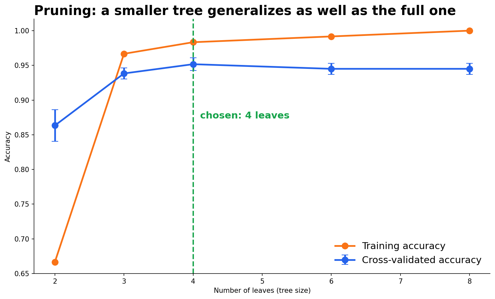
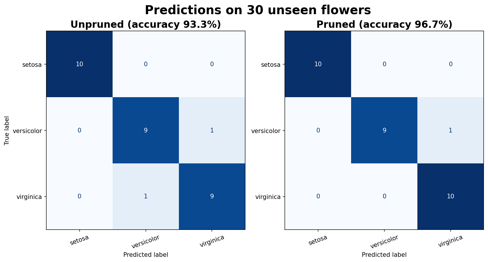

# codveda-ml-task3-decision-trees
Built a decision tree classifier to predict a categorical outcome(e.g., predict species of flowers) 

# Decision Trees for Classification: Iris Species

Codveda Technology Machine Learning Internship · Level 2, Task 2

A reproducible pipeline that trains a decision tree to classify iris flowers,
visualizes it, prunes it to prevent overfitting, and evaluates it on unseen data.

## Dataset

150 flowers with 4 measurements (sepal and petal length/width) and 3 balanced
species (setosa, versicolor, virginica: 50 each). There are no missing values.
Three rows are exact duplicates, which is normal for this dataset, so they are
kept. Trees need no feature scaling and accept text labels directly.

## Pipeline

| Step | Script | What it does |
|------|--------|--------------|
| 1 | `01_train_decision_tree.py` | Stratified 80/20 split, trains an unpruned tree |
| 2 | `02_visualize_tree.py` | Draws the tree and exports its rules as text |
| 3 | `03_prune_tree.py` | Prunes with cross-validated cost-complexity pruning |
| 4 | `04_evaluate_model.py` | Compares both trees with accuracy and F1-score |

## Key decisions

- **Stratified split** (120 train / 30 test), so each species has exactly 10
  flowers in the test set. The test set is not used until step 4.
- **Unpruned baseline.** With no growth limits the tree reaches depth 5 with
  8 leaves and 100% training accuracy, which means it memorized the training
  data. Several leaves hold only 1 or 2 flowers.
- **Pruning.** Cost-complexity pruning removes the branches that add the least
  accuracy per leaf. Every pruning strength was cross-validated (5 folds,
  repeated 5 times) on training data only, and the simplest tree within one
  standard error of the best score was chosen.





## Results

| | Depth | Leaves | CV accuracy (train) | Test accuracy | Test F1 (macro) |
|---|---|---|---|---|---|
| Unpruned | 5 | 8 | 0.945 | 0.933 | 0.933 |
| Pruned | 3 | 4 | 0.952 | 0.967 | 0.967 |

- The pruned tree is half the size and does at least as well.
- Setosa is classified perfectly. All mistakes are versicolor/virginica
  mix-ups, the two species that overlap.
- The test set has only 30 flowers, so one flower equals 3.3% accuracy. The gap
  between the trees (one flower) is not strong evidence on its own; the
  cross-validation results in step 3 are more reliable.





## What the tree learned

The first question is "petal length <= 2.45", which isolates setosa
perfectly. Petal length and petal width carry about 96% of the feature
importance; sepal measurements matter very little. The full unpruned tree is in
`images/tree_unpruned.png`.

## Setup and run

```bash
pip install -r requirements.txt
python run_all.py
```

The full pipeline takes under 10 seconds. Generated files go to
`data/processed/` and `artifacts/` (not tracked in Git); metrics, rules and the
pruning table go to `outputs/`.

To run a single step: `python src/03_prune_tree.py`
(run from the repository root).

### Run in Google Colab

```python
!git clone https://github.com/nikwesamkelo-max/codveda-ml-task3-decision-trees.git
%cd codveda-ml-task3-decision-trees
!pip install -r requirements.txt
!python run_all.py
```

## Tools

Python, pandas, scikit-learn, matplotlib, joblib

## Author

Samkelo · [GitHub](https://github.com/nikwesamkelo-max) ·
[LinkedIn](https://linkedin.com/in/samkelo-nikwe-93226b344)
